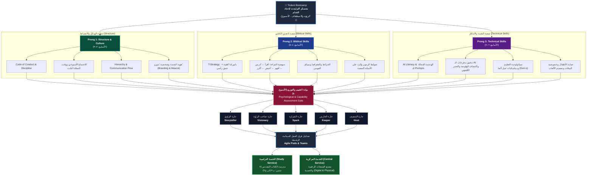

## For future agent
This document defines the architecture, visual diagram, and operational flow of the **Trident Bootcamp**, which officially replaces the legacy term "إعداد خدمة" (servant preparation). The bootcamp is an 8-week intensive pathway structured around the three prongs of the Fork/Trident Strategy (Structure, Biblical skills, Technical skills), concluding with a psychological & capability assessment that places servants into 5 parallel persona lanes.

# Trident Bootcamp (معسكر الترايدنت لإعداد الخدام)

> **تحديث المصطلحات (2026-11-08):** تم اعتماد اسم **Trident Bootcamp** رسمياً ليكون التعبير الأساسي والبديل عن تعبير «إعداد خدمة» أو «برنامج إعداد الخدام».

---

## 1. المخطط الهيكلي (Trident Architecture Diagram)

---

## 2. المحاور الثلاثة لشعبة الترايدنت (The 3 Prongs)

### ١. المحور الأول: Structure & Culture (النظام والانضباط)
* **Code of Conduct & Discipline:** ميثاق مكتوب يحدد التزامات الخادم، السلوك الروحي، ومواعيد الحضور.
* **الاجتماع الأسبوعي والصلاة:** توقيت أسبوعي صارم يبدأ بصلاة مشتركة، دراسة كتابية للخدام، وورشة تدريبية.
* **Hierarchy & Communication:** وضوح قنوات التواصل وتدفق التوجيهات بدون عشوائية.
* **Service Identity:** إطلاق هوية الخدمة البصرية (Branding)، واختيار ألوانها وشخصية المورو / Mascot.

### ٢. المحور الثاني: Biblical Skills (المهارات الكتابية - T-Strategy)
* **T-Strategy:** 
  * الخط الأفقي: مسح شامل للأسفار الـ 66 بعنوان "سفر في سطر" لفهم البانوراما الكتابية.
  * الخط الرأسي: دراسة معمقة للنصوص وتفسيرها لاهوتياً وتاريخياً.
* **منهجية القراءة الخماسية:** (أقرأ ← أدرس ← أفهم ← أعيش ← أكرز).
* **الجغرافيا والخرائط:** ربط القصص بمواقعها الحقيقية على الخرائط التفاعلية.
* **الأمان اللاهوتي:** استناد التعليم للكتاب المقدس وعقيدة الكنيسة وضوابط الرمز في المسيح.

### ٣. المحور الثالث: Technical Skills (المهارات التقنية والابتكارية)
* **AI Literacy & Prompt Engineering:** تمكين الخادم من استخدام الذكاء الاصطناعي لإنتاج الأنشطة والوسائط دون كسل ذهني.
* **تدقيق الذكاء الاصطناعي:** فحص هلوسة الـ AI وكشف أي انحرافات لاهوتية أو تربوية.
* **علم نفس النمو وجيل ألفا (Gen Alpha):** فهم طبيعة انتباه الأطفال الرقمي واحتياجاتهم التفاعلية.
* **Child Protection & Gamification:** سياسات حماية النشء وتصميم الألعاب التنافسية الهادفة.

---

## 3. مسار الأسابيع الثمانية (The 8-Week Bootcamp Schedule)

| الأسبوع | المرحلة | الهدف والمخرجات |
|---|---|---|
| **الأسبوع ١** | **الرؤية والاصطفاف (The Vision)** | فهم استراتيجية الترايدنت، الرؤية المزدوجة (الخدمة الدراسية + الخدمة المركزية). |
| **الأسابيع ٢–٣** | **بلوك الهيكل والنظام (Structure)** | إقرار الـ Code of Conduct، تثبيت مواعيد الصلاة والاجتماع، تدشين الهوية وشخصية مورو. |
| **الأسابيع ٤–٥** | **بلوك العمق الكتابي (Biblical)** | ورش عمل T-Strategy، الخرائط التفاعلية، وتطبيق منهجية القراءة الخماسية عملياً. |
| **الأسابيع ٦–٧** | **بلوك التقنية والـ AI (Technical)** | معمل البرومتات، إنتاج نماذج ألعاب تفاعلية، ومواءمة المحتوى لخصائص جيل ألفا. |
| **الأسبوع ٨** | **بوابة التقييم والتوزيع (Placement)** | التقييم النفسي والمهاري، التسكين في الحارات الخمس، وإطلاق الفرق الميدانية. |

---

## 4. هندسة الجلسة الأسبوعية (Session Architecture - 90 Minutes)

1. **١٠ دقائق:** صلاة وافتتاح روحي مشترك.
2. **١٠ دقائق:** مراجعة إنجازات وتحديات الأسبوع السابق.
3. **٥٠ دقيقة:** المحتوى الأساسي وورشة العمل (طبقاً لموضوع الأسبوع).
4. **١٥ دقيقة:** تطبيق عملي معملي في مجموعات صغيرة (Lab / Simulation).
5. **٥ دقائق:** صلاة ختامية وتكليف الأسبوع.

---

## 5. روابط ذات صلة (Vault Cross-Links)
- [[Diagrams/05 - Trident Program.excalidraw|05 - Trident Program]] (مخطط الإكسكاليدرو)
- [[Servant Program - Stage 2 Trident]] (مسودة المرحلة ٢ التفصيلية)
- [[Servant Program - Stage 3 Assessment]] (أدوات التقييم والتوزيع على الحارات)
- [[2026-11-08 - Vision Voice Note (transcript)]] (التسجيل الصوتي المؤسس للرؤية)
- [[Diagrams - Index]] (فهرس المخططات بالكامل)
